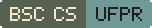
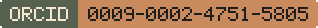

  

  
  
  

Hi, I'm Pedro! 👋

I'm a computer scientist from Brazil. I did my bachelor's in Computer Science at
the [Federal University of Paraná (UFPR)](https://ufpr.br), spent an exchange
year at [FAU Erlangen-Nürnberg](https://www.fau.eu) in Germany, and I'm now back
at UFPR doing my master's in cryptography.

My master's research is about keeping **vehicle-to-everything (V2X)
communication** (cars talking to each other and to the road around them) secure
even against attackers with quantum computers. That's what the two little cars
up there are doing: swapping a locked message.

Away from the keyboard you'll usually find me behind a camera 📷 or out on a
run 🏃.

- **Post-quantum cryptography**
- **Applied cryptography**
- **Attribute-based encryption (ABE)**
- **Secure V2X communication**

| Paper | Venue | Year | Links |
| ----- | ----- | ---- | ----- |
| _Coming soon_ | | | |

<!-- To add a paper, replace the row above with:
| Title of the paper | Venue | 2026 | [pdf](https://...) · [code](https://github.com/PedroTricossi/...) |
-->

- **[Gerenciador Fotografia](https://github.com/PedroTricossi/Gerenciador-fotografia)**:
  turns a form into a wedding-photography contract PDF, stores it, and keeps an
  audit trail of every action. Built for my own photography work and runs only
  on my machine. Python (FastAPI, SQLAlchemy, WeasyPrint) and React/TypeScript.

  
  
  

  

